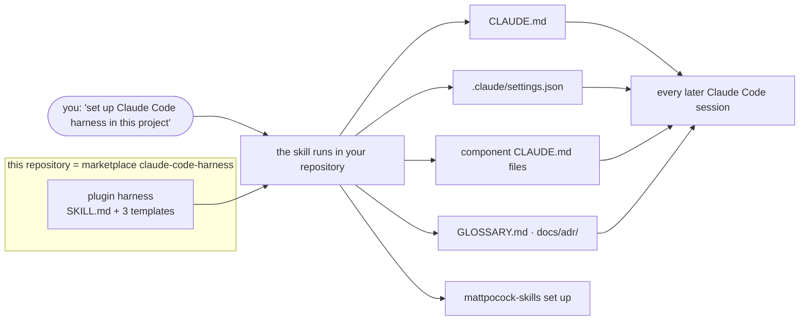

# claude-code-harness

**English** · [Русский](README.ru.md)

**`harness` is a Claude Code plugin that sets up the working environment Claude Code needs in your
repository — and keeps it lean.** One skill reads your project and writes a short `CLAUDE.md`, a
permission file that actually enforces, a `CLAUDE.md` per component where one is needed, and a
place for the project's knowledge. From then on every Claude Code session starts with your
commands, your boundaries, a way of working that was measured, and the decisions made so far —
instead of a blank slate.

It works for a new repository, an existing one, and one that already has a harness, including
large multi-component codebases developed over months.

> One opinion drives it: **under a capable model, the least harness that works wins.** A line
> stays only if it has a named basis — a measurement, a first-party source, published research or
> an established practice; everything else is cut.

## Why use it

| The problem | What the plugin does about it |
|---|---|
| Each Claude Code session starts knowing nothing about your project. | A short root `CLAUDE.md` (aimed at 60–90 lines, never over 120): the command that proves the project works, what must never happen, how work is done here, where knowledge lives. Only what a new teammate would have to be told — nothing the model can read from the code. |
| Harnesses grow until they cost more than they help: copied rulebooks, custom agents, hooks that block mid-write. | No agents, hooks or rulebooks — the commands are user-invoked and cost nothing until typed. The audit mode reports what to cut first, and every line it writes is paid for on every turn, so it writes few. |
| The agent builds the wrong thing, or says "done" without proof. | A *How we work* block: an interview before code, a spec with your interface copied verbatim, the build in the same session, "done" only with the command and its output, review by risk. Each line has a named basis — see [How we work — and why](#how-we-work--and-why). |
| Decisions get lost between sessions on a project that runs for months. | Terms go to a glossary, decisions — including ones stated "for later" — to ADRs, and a session reads the ones that touch an area before changing it. |
| A large repository: one instruction file can't fit every component. | A `CLAUDE.md` inside each component that has its own commands, invariants or contracts; Claude Code loads it only when work touches that directory. Contracts between components sit behind `ask`. |
| Permission rules that look right and match nothing. | Only the rule forms Claude Code matches; a check at the end of every run prints any rule that is dead, malformed or ignored. |
| You open a session and don't know where to start, or how to make the agent work well. | `/harness:start` says where work stands and the one command to type next; the other commands carry the measured prompts, so you never type them by hand. |
| The project's own procedures get rediscovered in every session. | A task the project solved after a long search becomes a project skill in `.claude/skills/` — `/harness:skill` writes it from that session, `/harness:trajectory` cuts its wasted steps after a real run. |
| Projects that also use other agents (Codex, others) through `AGENTS.md`. | `AGENTS.md` stays the source of truth; `CLAUDE.md` imports it, because Claude Code reads `AGENTS.md` only while no `CLAUDE.md` is on the path. |

## How it works



**1. The skill runs once per setup or audit.** Claude Code picks it up from its description when
you say one of its phrases. It then:

1. **Reads the room, without writing.** Git history, `.claude/`, every `CLAUDE.md` and
   `AGENTS.md`, workspace manifests, CI, any existing decision log.
2. **Classifies the project.** Its state (new, existing without a harness, existing with one), its
   shape (one component or several) and its horizon (short, or months of work).
3. **Asks only what the repository can't answer**, in one round: what must never happen, which
   paths are sensitive, which command proves the project works.
4. **Takes one of three paths.**
   - **New:** a harness with honest `TBD`s instead of invented commands.
   - **Existing:** maps the components, runs each test command once, and seeds the glossary and
     ADRs only from what the code can't tell.
   - **Already harnessed:** has you run Claude Code's own audits, reports gaps worst first, and
     edits only what you approve.
5. **Writes the files** from the templates below and sets up the companion plugin.
6. **Verifies** the permission rules, that a fresh session can name the project's check command
   and its prohibitions, and the line budgets.
7. **Hands over** in a commit that says what landed and what was left out.

**2. After that, the plugin is not involved.** Your repository carries the harness, and Claude
Code uses it on its own:

- the root `CLAUDE.md` loads in every session;
- a component's `CLAUDE.md` loads when work touches that directory;
- `.claude/settings.json` enforces the deny list;
- sessions read the glossary and ADRs before touching an area, because `CLAUDE.md` says so;
- the process tools from [mattpocock-skills](https://github.com/mattpocock/skills) — `/to-spec`,
  `/to-tickets`, `/implement`, `/wayfinder`, `/retro`, `/triage` — run when you type them.

**3. Day to day, you type commands.** Every session starts with `/harness:start`; the rest of the
flow is a handful of commands that carry its prompts — see [Commands](#commands) and the
[manual](docs/manual.md).

## What lands in your repository

| File | What it holds |
|---|---|
| `CLAUDE.md` (≤ 120 lines) | Purpose · *Commands* (the whole-repo check) · *Boundaries* (always / ask first / never) · *How we work* · *Project knowledge*. Starts with `@AGENTS.md` where the project keeps one. |
| `.claude/settings.json` | `deny` for secrets, `.git/`, force-push and hard reset; `ask` for push, rebase and amend; read-only git commands allowed; auto memory off. Tuned to what the project has. |
| `<component>/CLAUDE.md` (≤ 60 lines) | Only in a multi-component repository, and only where a component has its own commands, invariants or contracts. |
| `GLOSSARY.md`, `docs/adr/` | Created on the first real term or decision, never empty. In a project that already keeps decisions, that log stays the home. |
| `.out-of-scope/`, `docs/research/` | Created when first needed: a "no" later work must remember, and research for a decision still open. |

## Repository layout

```
.claude-plugin/marketplace.json   the marketplace catalog: one plugin
plugins/harness/                  the plugin — the only thing that ships into Claude Code
  .claude-plugin/plugin.json      name, description, version (the update key)
  skills/harness/SKILL.md         the setup skill: the run described above
  skills/harness/templates/       CLAUDE.md · component-CLAUDE.md · settings.json
  skills/<command>/SKILL.md       the commands: start, task, bugfix, tests, build, check, wrap, skill, trajectory
docs/manual.md                    the day-to-day flow, for people
evals/                            the kit's own regression suite: mechanical checks + sessions on fixtures
scripts/release.sh                the release ritual (maintainers)
CHANGELOG.md                      every change, and what to do when updating
```

## Install

```
/plugin marketplace add nikitaCodeSave/claude-code-harness
/plugin install harness@claude-code-harness
/plugin install mattpocock-skills --marketplace mattpocock/skills
```

The second plugin brings the process tools the harness points at. Without it, specs live in
`specs/<slug>.md` and tickets as files under `specs/<slug>/`.

Make these settings once, in your **user** settings (`~/.claude/settings.json`). Merge them into
the file you have:

```json
{
  "permissions": { "deny": ["Skill(mattpocock-skills:tdd)"] },
  "extraKnownMarketplaces": {
    "claude-code-harness": {
      "source": { "source": "github", "repo": "nikitaCodeSave/claude-code-harness" },
      "autoUpdate": true
    },
    "mattpocock": {
      "source": { "source": "github", "repo": "mattpocock/skills" },
      "autoUpdate": true
    }
  }
}
```

- **The deny** keeps `/tdd` out, so `/implement` builds without a test-first ritual (why below).
- **`autoUpdate`** turns on updates, which are off by default for third-party marketplaces. If
  your settings set `DISABLE_AUTOUPDATER`, `DISABLE_UPDATES` or
  `CLAUDE_CODE_DISABLE_NONESSENTIAL_TRAFFIC`, plugin updates also need
  `"FORCE_AUTOUPDATE_PLUGINS": "1"` under `env`.

## Use

Open the project at its root and say:

> **"set up Claude Code harness in this project"**

The same phrase works in every state; the skill picks the path from what it reads. Then:

- **Once per repository:** run `/setup-matt-pocock-skills` (tracker, labels, where domain docs
  live).
- **A large effort whose route isn't clear yet:** make the first session `/wayfinder`.
- **Always start Claude Code at the repository root:** the shared settings and their deny list
  load from the directory a session starts in.
- **Every few months, or after a model upgrade:** say **"audit my Claude Code harness"** — the cut
  matters more than the additions.

## Commands

The plugin's commands carry the way of working, so you work on the task instead of on the agent.
They are user-invoked: none of them costs context until you type it.

| Situation | Type |
|---|---|
| Any session, first thing — or whenever unsure | `/harness:start` — where work stands and the one command to type next |
| A new change | `/harness:task <what you want>` — interview, spec, build in the same session |
| A bug | `/harness:bugfix <the bug>` — a failing test first, then the fix |
| A raw idea to discuss or challenge first | `/grill-with-docs <the idea>` (mattpocock-skills), then `/harness:task` |
| A risky change is built | `/harness:check` — a fresh read-only reviewer against the spec, then the fixes (ordinary change: `/code-review`) |
| End of the session | `/harness:wrap` — decisions and terms not yet written down, evidence, commit |
| Work too big for one session | `/harness:task` → `/to-spec` → `/to-tickets` → `/harness:wrap`; per ticket `/harness:tests <ticket>`, then `/harness:build <ticket>` in a fresh session |
| A task finally solved after a long search, or one that keeps coming back | `/harness:skill <what it does>` — a project skill from what the session learned; `/harness:trajectory` after its next run, to cut the wasted steps |

The [manual](docs/manual.md) walks through each of them.

## How we work — and why

The *How we work* block every project gets, with what each line rests on. Measured in the
maintainer's lab with a hidden test oracle, N=3 per cell, a frontier model implementing and a
second model playing the product owner; a script write-protected stages from each other and the
repositories carried no `CLAUDE.md`. Two rigs:

- **single session** — 63 runs on three small single-language tasks with hidden requirements;
- **multi-session** — 9 runs of one project built as three features in new sessions, with an owner
  who keeps no memory between features and states some decisions only once, "for later".

- **Interview before code**, then write the spec (single session). Where the owner did not correct
  the agent's final report: without the interview, full acceptance in 3 of 9 runs; with it, 7 to 9
  of 9, depending on where the build ran.
- **The interface you fixed goes into the spec verbatim.** In a smoke run, one dropped interface
  line zeroed an acceptance suite.
- **Build in the session that wrote the spec.** Same session: 8 of 9 runs, the cheapest flow that
  held that rate. A fresh session building from the file alone: 7 of 9. With acceptance tests
  first written from the spec in a separate session, read-only for the implementer: 9 of 9.
- **The `CLAUDE.md` holds the flow; the commands are navigation.** With the kit's `CLAUDE.md` and a
  plain request, sessions interviewed, wrote the spec and reported the test command with its output
  in 9 of 9 runs, full acceptance in 9 of 9; through `/harness:task`, 8 of 9 — within noise. Across
  series, the template cost 1.7–2.4× the same flow typed as one prompt (medians); which of its parts
  that comes from is not separated.
- **Work that won't fit one session**: tickets, each built in a fresh session from tests written
  beforehand from its criteria — an extension of the result above, not measured on its own. Only
  then: in the multi-session rig, a ticket flow without the tests-first step, run on features that
  fit one session, cost 11×, took five times the owner's turns and lost a decision.
- **One implementer at a time.** A pipeline with grilling, tickets, `/tdd` and 12–22 subagents
  reached the same acceptance at 3.1–4.4× the cost of a sequential flow (factors not separated); a
  controlled external study that isolated parallelism saw parallel subagents lose resolve rate on
  bounded tasks.
- **No test-first ritual.** A flow without it (with acceptance tests from a separate session)
  stayed within 0.05 mutation score of a `/tdd` pipeline; an external study found no gain at
  3–8.5× the tokens. A test must be able to fail, and "done" comes with the command and its output.
- **Knowledge in files**: terms in the glossary, decisions — including ones stated "for later" — in
  ADRs, read before touching an area (multi-session). A frontier model kept earlier decisions in
  3 of 3 runs without the rule — it wrote them into a file on its own — and in 3 of 3 with it, at
  about +17% cost. In one smoke run outside the planned design, a weaker model kept 8 of 19 checks
  without the rule and 18 of 19 with it. The rule is insurance against one model's habit, not a
  measured gain on the frontier model.
- **A decision is written when made, with the change that applies it**; the spec carries each
  decision its interview settled, with why and what it was chosen over, and `/harness:wrap` only
  catches what was missed. In the measured runs the ADRs were written this way — there was no
  end-of-session step. Grounds: where ADR practice names a moment, it is before or during the
  decision (Nygard's and Fowler's `proposed` status, AWS's review before acceptance); spec-driven
  tools record a task's decisions before code, with the reason and the rejected options (Spec Kit,
  OpenSpec); mattpocock-skills say "don't batch these up"; Claude Code's docs warn that an
  instruction given only in conversation may not survive compaction. Whether the moment changes
  what survives has not been measured.
- **Finished and dropped work leaves no files; a changed decision is marked.** A finished,
  reviewed spec file goes once every line lives in a test, an ADR, the glossary or the commit message (a spec in a
  tracker is closed there); work you explicitly drop goes too, with its tests, code and tickets; a
  replaced ADR gets the status `superseded by NNNN`, and sessions skip ADRs marked deprecated or
  superseded. Nothing is removed without your confirmation: `/harness:wrap` proposes each removal
  and commits the work first, so git keeps it. Grounds: once its criteria are tests, a finished
  spec restates its own oracle and drifts from the code unnoticed — the maintainer's documentation
  rule puts the oracle before prose, after one live project where 55% of commits touched only
  Markdown to keep prose in step with code. Nygard's ADR format keeps a reversed decision and marks
  it superseded; mattpocock-skills offer the same statuses, plus `proposed`, as optional
  frontmatter, create these files only when there is something to write, and keep rejected
  requests in `.out-of-scope/`, deleting the file when a rejection is reversed; `_Avoid_` is their
  glossary format. Their writing guide
  names the same dynamic for agent instructions: stale layers settle because adding feels safe and
  removing feels risky. The lab has not measured the effect on sessions.
- **Auto memory off in the project.** First-party: it is on by default, Claude writes it itself,
  and a project setting turns it off. Memory written outside review and outside the repository keeps
  facts the project has revised; mattpocock-skills keep a project's language and decisions in
  reviewed, versioned files instead — the glossary and ADRs. The lab has not measured the effect. On an existing project, its project facts move into ADRs or `CLAUDE.md`
  first; a teammate can turn it back on for themselves in `.claude/settings.local.json`.
- **Review by risk**, against the spec, correctness only, at most three rounds (first-party
  guidance: "a reviewer that's asked to find problems will always find something"). In the lab a
  spec review found issues in 3 of 18 runs, none that changed hidden acceptance.

## What it deliberately doesn't do

- **No machinery.** No custom agents or hooks, and no rulebook copied into `.claude/docs/`. The
  commands are user-invoked and cost nothing until typed; project skills grow later, from tasks the
  project solved.
- **No enforcement of the process.** *How we work* is a set of instructions. Only what a
  permission rule can express is enforced. In the measured runs sessions followed the block
  unprompted (above); where a step is skipped, the manual gives the line to type.
- **No journal, and no pinned model or Claude Code version** in your project's files.
- **Not a replacement for CI or human review.** The harness tells the agent how to work; your
  checks still decide what merges.

## Updating

The version in `plugins/harness/.claude-plugin/plugin.json` is what Claude Code compares. With
`autoUpdate` on, a new release arrives in the background of an interactive session and loads in
the next one. Otherwise run `claude plugin update harness@claude-code-harness`.
[CHANGELOG.md](CHANGELOG.md) lists every change and what to do when updating.

## Developing the kit

- `AGENTS.md` holds the maintainer rules.
- `./evals/run.sh mech` runs the mechanical checks: JSON parses, links resolve, budgets, no version
  pins, no dead permission forms, no history in shipped instructions.
- `./evals/run.sh sessions` runs three headless sessions on fixtures.
- `scripts/release.sh <version>` versions and stages a release.

The measurements behind *How we work* come from the maintainer's lab; the README section above
states their conditions.

## License

MIT
