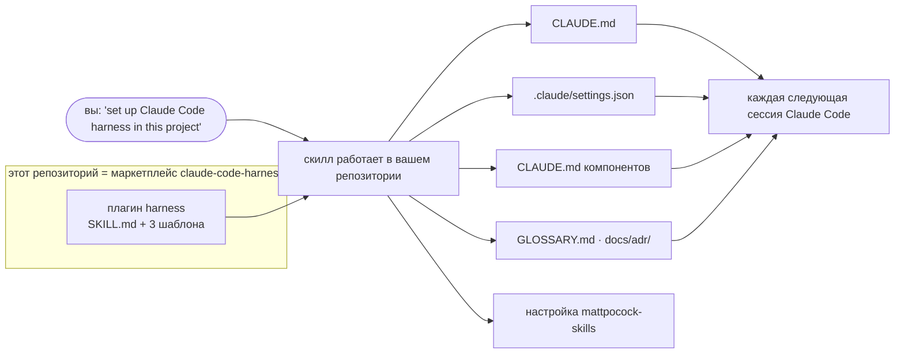

# claude-code-harness

[English](README.md) · **Русский**

**`harness` — плагин Claude Code, который настраивает в вашем репозитории рабочее окружение,
нужное Claude Code, и держит его компактным.** Один скилл читает проект и пишет короткий
`CLAUDE.md`, файл прав, который действительно что-то запрещает, `CLAUDE.md` для тех компонентов,
которым он нужен, и место для знаний проекта. После этого каждая сессия Claude Code начинается с
ваших команд, ваших границ, измеренного способа работы и уже принятых решений, а не с чистого листа.

Подходит для нового репозитория, для существующего и для такого, где обвязка уже есть, в том
числе для больших многосоставных кодовых баз, которые развиваются месяцами.

> В основе одна позиция: **при способной модели выигрывает минимальная обвязка, которая
> работает.** Строка остаётся, только если за ней стоит замер или первоисточник; всё остальное
> вырезано.

## Зачем это нужно

| Проблема | Что с ней делает плагин |
|---|---|
| Каждая сессия Claude Code начинается без знания о проекте. | Короткий корневой `CLAUDE.md` (цель — 60–90 строк, не больше 120): команда, которая доказывает, что проект работает; что не должно случиться никогда; как здесь работают; где лежат знания. Только то, что пришлось бы сказать новому члену команды, — ничего, что модель сама прочтёт из кода. |
| Обвязка разрастается, пока не начинает стоить дороже, чем даёт: скопированные своды правил, свои агенты, хуки, блокирующие запись на полуслове. | Ни агентов, ни хуков, ни сводов правил — команды вызываете вы сами, и до вызова они ничего не стоят. Режим аудита первым делом говорит, что вырезать, а каждая написанная строка оплачивается на каждом ходу, поэтому он пишет мало. |
| Агент собирает не то или говорит «готово» без доказательств. | Блок *How we work*: интервью до кода, спека с вашим интерфейсом дословно, сборка в той же сессии, «готово» только вместе с командой и её выводом, ревью по уровню риска. Каждая строка опирается на замер — см. [Как работать — и почему](#как-работать--и-почему). |
| На проекте длиной в месяцы решения теряются между сессиями. | Термины — в глоссарий, решения (включая сказанные «на будущее») — в ADR, а перед изменением области сессия читает те, что её касаются. |
| Большой репозиторий: один файл инструкций не вмещает все компоненты. | `CLAUDE.md` внутри каждого компонента, у которого есть свои команды, инварианты или контракты; Claude Code загружает его, только когда работа касается этого каталога. Контракты между компонентами — под `ask`. |
| Правила прав выглядят правильно, а не срабатывают ни на что. | Только те формы правил, которые Claude Code действительно сопоставляет; проверка в конце каждого запуска печатает любое мёртвое, битое или проигнорированное правило. |
| Вы открываете сессию и не знаете, с чего начать и как заставить агента работать хорошо. | `/harness:start` говорит, где сейчас работа и какую одну команду вводить следующей; остальные команды несут измеренные промпты, так что вручную их не набирать. |
| Собственные процедуры проекта каждая сессия открывает заново. | Задача, которую проект решил после долгих поисков, становится проектным скиллом в `.claude/skills/`: `/harness:skill` пишет его из этой сессии, `/harness:trajectory` убирает лишние шаги после реального прогона. |
| Проект использует и других агентов (Codex и т. п.) через `AGENTS.md`. | `AGENTS.md` остаётся источником истины, а `CLAUDE.md` его импортирует: Claude Code читает `AGENTS.md`, только пока на пути нет `CLAUDE.md`. |

## Как это работает



**1. Скилл запускается один раз — на установку или аудит.** Claude Code подхватывает его по
описанию, когда вы произносите одну из его фраз. Дальше скилл:

1. **Осматривается, ничего не записывая.** История git, `.claude/`, все `CLAUDE.md` и
   `AGENTS.md`, манифесты workspace, CI, уже существующий журнал решений.
2. **Классифицирует проект.** Состояние (новый, существующий без обвязки, существующий с ней),
   форму (один компонент или несколько) и горизонт (короткий или месяцы работы).
3. **Спрашивает только то, чего не видно из репозитория**, одним раундом: что не должно случиться
   никогда, какие пути чувствительные, какая команда доказывает, что проект работает.
4. **Идёт по одному из трёх путей.**
   - **Новый проект:** обвязка с честными `TBD` вместо выдуманных команд.
   - **Существующий:** составляет карту компонентов, один раз прогоняет каждую команду тестов и
     заполняет глоссарий и ADR только тем, чего не видно из кода.
   - **Обвязка уже есть:** просит вас запустить встроенные аудиты Claude Code, сообщает о
     пробелах, начиная с худших, и правит только то, что вы одобрили.
5. **Пишет файлы** по шаблонам ниже и настраивает плагин-компаньон.
6. **Проверяет** правила прав, то, что свежая сессия называет команду проверки проекта и его
   запреты, и бюджеты строк.
7. **Передаёт работу** коммитом, в котором сказано, что поставлено и что сознательно оставлено.

**2. После этого плагин не участвует.** Обвязку несёт ваш репозиторий, и Claude Code пользуется
ею сам:

- корневой `CLAUDE.md` загружается в каждую сессию;
- `CLAUDE.md` компонента загружается, когда работа касается его каталога;
- `.claude/settings.json` применяет список запретов;
- сессии читают глоссарий и ADR перед изменением области, потому что так сказано в `CLAUDE.md`;
- инструменты процесса из [mattpocock-skills](https://github.com/mattpocock/skills) — `/to-spec`,
  `/to-tickets`, `/implement`, `/wayfinder`, `/retro`, `/triage` — запускаются, когда вы их
  вводите.

**3. В повседневной работе вы вводите команды.** Каждая сессия начинается с `/harness:start`;
остальной поток — несколько команд, несущих его промпты, — см. [Команды](#команды) и
[мануал](docs/manual.ru.md).

## Что появляется в вашем репозитории

| Файл | Что в нём |
|---|---|
| `CLAUDE.md` (≤ 120 строк) | Назначение · *Commands* (проверка всего репозитория) · *Boundaries* (всегда / сначала спросить / никогда) · *How we work* · *Project knowledge*. Начинается с `@AGENTS.md`, если в проекте он есть. |
| `.claude/settings.json` | `deny` для секретов, `.git/`, force-push и hard reset; `ask` для push, rebase и amend; команды git только для чтения разрешены. Подстраивается под то, что есть в проекте. |
| `<component>/CLAUDE.md` (≤ 60 строк) | Только в многосоставном репозитории и только там, где у компонента есть свои команды, инварианты или контракты. |
| `GLOSSARY.md`, `docs/adr/` | Создаются на первом настоящем термине или решении, пустыми не бывают. Если проект уже ведёт журнал решений, он и остаётся их местом. |

## Устройство репозитория

```
.claude-plugin/marketplace.json   каталог маркетплейса: один плагин
plugins/harness/                  плагин — единственное, что уезжает в Claude Code
  .claude-plugin/plugin.json      имя, описание, версия (ключ обновления)
  skills/harness/SKILL.md         скилл установки: запуск, описанный выше
  skills/harness/templates/       CLAUDE.md · component-CLAUDE.md · settings.json
  skills/<команда>/SKILL.md       команды: start, task, bugfix, tests, build, check, wrap, skill, trajectory
docs/manual.md                    повседневный поток, для людей
evals/                            регрессия самого кита: механические проверки + сессии на фикстурах
scripts/release.sh                ритуал релиза (для мейнтейнеров)
CHANGELOG.md                      все изменения и что делать при обновлении
```

## Установка

```
/plugin marketplace add nikitaCodeSave/claude-code-harness
/plugin install harness@claude-code-harness
/plugin install mattpocock-skills --marketplace mattpocock/skills
```

Второй плагин даёт инструменты процесса, на которые опирается обвязка. Без него спеки лежат в
`specs/<slug>.md`, а тикеты — файлами в `specs/<slug>/`.

Один раз пропишите в **пользовательских** настройках (`~/.claude/settings.json`), добавив к тому,
что там уже есть:

```json
{
  "permissions": { "deny": ["Skill(mattpocock-skills:tdd)"] },
  "extraKnownMarketplaces": {
    "claude-code-harness": {
      "source": { "source": "github", "repo": "nikitaCodeSave/claude-code-harness" },
      "autoUpdate": true
    },
    "mattpocock": {
      "source": { "source": "github", "repo": "mattpocock/skills" },
      "autoUpdate": true
    }
  }
}
```

- **Запрет** не пускает `/tdd`, поэтому `/implement` собирает без ритуала test-first (почему —
  ниже).
- **`autoUpdate`** включает обновления: у сторонних маркетплейсов они по умолчанию выключены. Если
  в ваших настройках задан `DISABLE_AUTOUPDATER`, `DISABLE_UPDATES` или
  `CLAUDE_CODE_DISABLE_NONESSENTIAL_TRAFFIC`, обновлениям плагинов нужен ещё
  `"FORCE_AUTOUPDATE_PLUGINS": "1"` в `env`.

## Использование

Откройте проект из его корня и скажите:

> **«set up Claude Code harness in this project»**

Фраза одна для любого состояния: путь скилл выбирает по тому, что прочёл. Дальше:

- **Один раз на репозиторий:** запустите `/setup-matt-pocock-skills` (трекер, метки, где лежат
  доменные документы).
- **Большая работа, путь которой ещё не ясен:** первой сессией сделайте `/wayfinder`.
- **Всегда запускайте Claude Code из корня репозитория:** общие настройки и их список запретов
  читаются из каталога, где стартует сессия.
- **Раз в несколько месяцев или после смены модели:** скажите **«audit my Claude Code harness»** —
  вырезать важнее, чем добавлять.

## Команды

Способ работы несут команды плагина, поэтому вы заняты задачей, а не агентом. Их вызываете вы сами:
пока команда не введена, она ничего не стоит в контексте.

| Ситуация | Что вводить |
|---|---|
| Начало любой сессии — или когда не уверены, что дальше | `/harness:start` — где сейчас работа и какую одну команду вводить следующей |
| Новое изменение | `/harness:task <что нужно>` — интервью, спека, сборка в той же сессии |
| Баг | `/harness:bugfix <баг>` — сначала падающий тест, потом исправление |
| Сырая идея, которую сначала хочется обсудить или прожарить | `/grill-with-docs <идея>` (mattpocock-skills), затем `/harness:task` |
| Рискованное изменение собрано | `/harness:check` — свежий ревьюер только для чтения против спеки, затем исправления (обычное изменение — `/code-review`) |
| Конец сессии | `/harness:wrap` — решения в ADR, термины в глоссарий, доказательство, коммит |
| Работа не на одну сессию | `/harness:task` → `/to-spec` → `/to-tickets` → `/harness:wrap`; на каждый тикет `/harness:tests <тикет>`, затем `/harness:build <тикет>` в свежей сессии |
| Задача наконец решена после долгих поисков или повторяется снова и снова | `/harness:skill <что делает>` — проектный скилл из того, что узнала сессия; `/harness:trajectory` после следующего прогона — убрать лишние шаги |

[Мануал](docs/manual.ru.md) разбирает каждую из них.

## Как работать — и почему

Блок *How we work*, который получает каждый проект, и на чём держится каждая его строка. Замеры
сделаны в лаборатории мейнтейнера: скрытый тестовый оракул, N=3 на ячейку, реализует передовая
модель, владельца продукта играет вторая модель; скрипт защищал стадии от записи друг другом, в
репозиториях не было `CLAUDE.md`. Два стенда:

- **одна сессия** — 63 прогона на трёх небольших задачах на одном языке со скрытыми требованиями;
- **много сессий** — 9 прогонов одного проекта, собранного как три фичи в новых сессиях; владелец
  не помнит ничего между фичами и некоторые решения называет только один раз, «на будущее».

- **Интервью до кода**, потом спека (одна сессия). Если владелец не правит итоговый отчёт
  агента: без интервью полная приёмка в 3 из 9 прогонов, с ним — в 7–9 из 9, в зависимости от
  того, где шла сборка.
- **Зафиксированный вами интерфейс идёт в спеку дословно.** В дымовом прогоне одна выпавшая строка
  интерфейса обнулила набор приёмочных тестов.
- **Сборка в той же сессии, что писала спеку.** Та же сессия: 8 из 9 прогонов, самый дешёвый поток
  с таким результатом. Свежая сессия, собирающая только по файлу: 7 из 9. С приёмочными тестами,
  написанными по спеке заранее в отдельной сессии и закрытыми для исполнителя на запись: 9 из 9.
- **Работа не на одну сессию**: тикеты, каждый собирается в свежей сессии по тестам, заранее
  написанным из его критериев, — это расширение результата выше, отдельно не измеренное. Только
  тогда: на многосессионном стенде поток по тикетам без шага с тестами, запущенный на фичах,
  помещающихся в одну сессию, стоил в 11 раз дороже, потребовал впятеро больше ходов владельца и
  потерял решение.
- **Один исполнитель за раз.** Пайплайн с грилингом, тикетами, `/tdd` и 12–22 субагентами дал ту
  же приёмку в 3.1–4.4 раза дороже последовательного потока (факторы не разделены); контролируемое
  внешнее исследование, где параллельность изолирована, показало, что параллельные субагенты
  решают ограниченные задачи хуже.
- **Без ритуала test-first.** Поток без него (с приёмочными тестами из отдельной сессии) остался в
  пределах 0.05 по mutation score от пайплайна с `/tdd`; внешнее исследование не нашло выигрыша
  при расходе токенов в 3–8.5 раза больше. Тест должен уметь падать, а «готово» приходит с командой
  и её выводом.
- **Знания в файлах**: термины в глоссарии, решения — включая сказанные «на будущее» — в ADR,
  прочитанные перед изменением области (много сессий). Передовая модель сохранила прежние решения
  в 3 из 3 прогонов без этого правила — записала их в файл сама — и в 3 из 3 с ним, примерно на 17%
  дороже. В одном дымовом прогоне вне запланированного дизайна более слабая модель выдержала 8 из
  19 проверок без правила и 18 из 19 с ним. Правило — страховка от привычки одной модели, а не
  измеренный выигрыш на передовой.
- **Ревью по уровню риска**, против спеки, только корректность, не больше трёх раундов (по
  рекомендации первоисточника: «ревьюер, которого просят найти проблемы, всегда что-нибудь
  найдёт»). В лаборатории ревью против спеки нашло замечания в 3 из 18 прогонов, и ни одно не
  изменило скрытую приёмку.

## Чего плагин сознательно не делает

- **Никакой машинерии.** Ни своих агентов, ни хуков, ни свода правил, скопированного в
  `.claude/docs/`. Команды вызываете вы сами, и до вызова они ничего не стоят; проектные скиллы
  вырастают позже — из задач, которые проект решил.
- **Не принуждает к процессу.** *How we work* — это инструкции. Принудительно действует только то,
  что выражается правилом прав. Следует ли сессия блоку без подсказок оператора, отдельно не
  измерено — мануал даёт строку, которую нужно ввести, если шаг пропущен.
- **Никакого журнала и никаких закреплённых версий модели или Claude Code** в файлах проекта.
- **Не заменяет CI и ревью людьми.** Обвязка говорит агенту, как работать; что попадёт в основную
  ветку, решают ваши проверки.

## Обновление

Claude Code сравнивает версию из `plugins/harness/.claude-plugin/plugin.json`. С включённым
`autoUpdate` новый релиз приходит в фоне интерактивной сессии и загружается в следующей.
Иначе — `claude plugin update harness@claude-code-harness`. [CHANGELOG.md](CHANGELOG.md) перечисляет
все изменения и что делать при обновлении.

## Разработка кита

- `AGENTS.md` — правила для мейнтейнеров.
- `./evals/run.sh mech` — механические проверки: JSON разбирается, ссылки ведут куда надо, бюджеты
  соблюдены, нет закреплённых версий, мёртвых форм правил прав и истории в отгружаемых инструкциях.
- `./evals/run.sh sessions` — три headless-сессии на фикстурах.
- `scripts/release.sh <version>` — версионирует и подготавливает релиз.

Замеры, на которых стоит *How we work*, сделаны в лаборатории мейнтейнера; их условия — в разделе
выше.

## Лицензия

MIT
